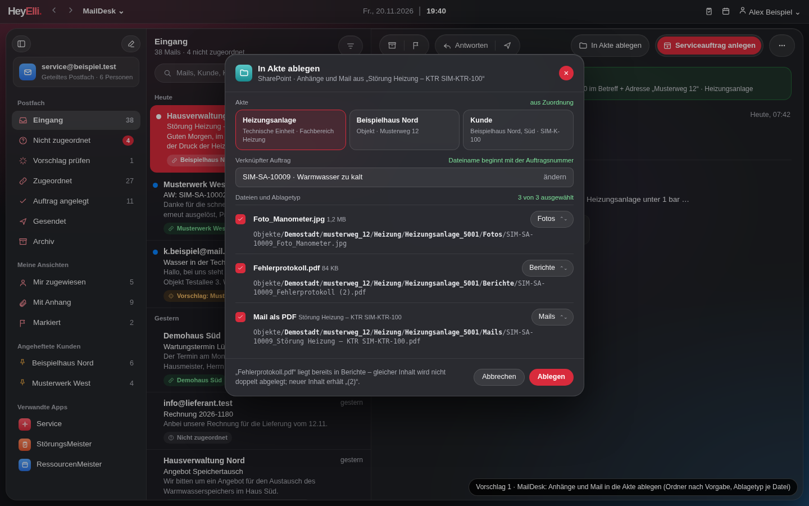
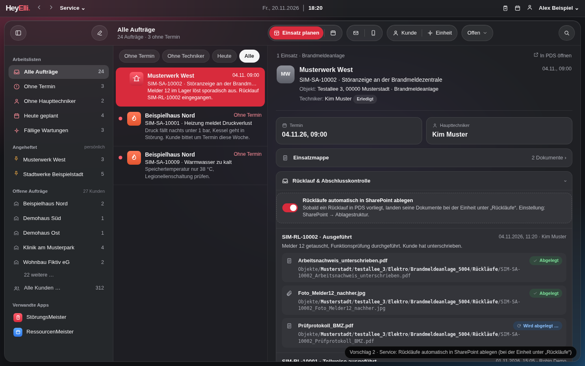

# Ideen

Festgehaltene Vorschläge, die noch nicht beauftragt sind. Jede Idee nennt Nutzen, Voraussetzungen und offene Fragen; umgesetzt wird erst nach Freigabe. Mockups enthalten ausschließlich fiktive Daten.

## SharePoint – MailDesk-Anhänge in die Akte ablegen

*Stand: 21.11.2026 · Status: Idee, Mockup vorhanden*

- In MailDesk neben „Serviceauftrag anlegen“ eine Aktion **„In Akte ablegen“**.
- **Akte:** vorausgewählt ist die Akte aus der Zuordnung (technische Einheit, sonst Objekt, sonst Kunde); umschaltbar.
- **Je Datei** ein Häkchen und ein eigener Ablagetyp (z. B. Foto → Fotos, Protokoll → Berichte). Die Mail selbst kann als PDF unter „Mails“ mit abgelegt werden.
- Ist ein Serviceauftrag verknüpft, beginnen die Dateinamen mit der Auftragsnummer.
- Zielpfad je Datei sichtbar, nach der [SharePoint-Ordnerstruktur](operations/sharepoint.md#zuordnung-und-dateiablage), z. B. `Objekte/Demostadt/musterweg_12/Heizung/Heizungsanlage_5001/Fotos/SIM-SA-10009_Foto_Manometer.jpg`.
- Bereits abgelegte Anhänge sind in der Mail markiert. Gleicher Inhalt wird nicht doppelt abgelegt; neuer Inhalt mit gleichem Namen erhält „(2)“.

**Voraussetzungen:** MailDesk mit Microsoft 365 (`Mail.Read` auf das geteilte Postfach), SharePoint freigegeben (vorhandenes Schreibrecht `Sites.Selected`). Keine neuen SharePoint-Rechte.

**Offen:** Format für „Mail als PDF“ (PDF-Erzeugung oder Original `.eml`); Größenlimit 8 MiB je Datei gilt auch für Anhänge; ob MailDesk-Benutzer zusätzlich Service-Schreibrecht brauchen.

## SharePoint – Rückläufe automatisch ablegen

*Stand: 21.11.2026 · Status: Idee, Mockup vorhanden*

- Schalter **„Rückläufe automatisch in SharePoint ablegen“** unter Einstellungen → SharePoint → Ablagestruktur.
- Sobald ein Rücklauf in PDS vorliegt, werden seine Dokumente (z. B. unterschriebener Arbeitsnachweis, Fotos, Prüfprotokolle) bei der Einheit des Auftrags unter „Rückläufe“ abgelegt, Dateiname mit Auftragsnummer.
- In der Auftragsakte unter „Rücklauf & Abschlusskontrolle“ steht je Dokument der Status (Abgelegt · Wird abgelegt · Erneut versuchen) mit Zielpfad.
- Ist SharePoint nicht erreichbar, geht nichts verloren; der Versuch wird automatisch wiederholt. Bestehende Dateien werden nie überschrieben.

**Voraussetzungen:** SharePoint freigegeben; Rücklaufdokumente aus PDS abrufbar.

**Offen (vor Umsetzung gegen OpenAPI und Handbuch prüfen, nicht annehmen):** ob PDS Rücklaufdokumente über die API als Datei liefert oder nur als Verweis; wann ein Rücklauf als „vorliegend“ gilt (Status); ob die Ablage im Hintergrund (Überwachungsdienst) oder beim Öffnen der Akte angestoßen wird; Verhalten im Testbetrieb (keine Schreibzugriffe auf Microsoft 365).

## Weitere SharePoint-Vorschläge (21.11.2026, noch ohne Mockup)

3. Prüffristen aus Dokumenten (Dokumentart, „gültig bis“, Warnung im Cockpit)
4. Dokumente aus Word-Vorlagen erzeugen (Servicebericht, Angebot, Terminbestätigung)
5. Einsatzmappe als Sammel-PDF für Techniker
6. Fotodokumentation direkt vom Handy in die Einheitenakte
7. Volltextsuche in Dokumenten (mit `Sites.Selected` nur eingeschränkt – mit IT klären)
8. Versionen und Freigabestatus von Dokumenten anzeigen
9. Prüfberichte zeitlich begrenzt für Kunden freigeben (nur mit Regel der IT zu externen Freigaben)
10. Aufbewahrungsfristen als Prüfhinweis und Bericht über verwaiste Ordner
